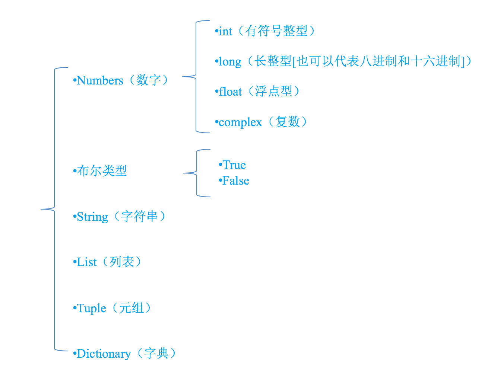
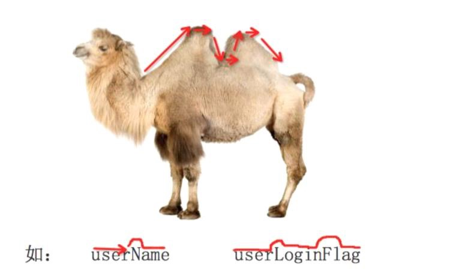

### Python简介

* Python的作者是`Guido van Rossum（龟叔） `。
* Python正式诞生于`1991 `年。
* Python 的解释器有多种实现。最常见的是 `CPython`（官方 C 语言实现），另外还有 `Jython`（跑在 Java 平台）、`IronPython`（跑在 .NET 和 Mono）、`PyPy`（Python 实现，支持 JIT）。
* Python目前有两个版本，`Python2 `和`Python3 `，最新版分别为2.7.13和3.6.2。
* 常见口号：`Life is short, you need Python.`

#### (本博客以python3为例介绍python的用法)

### Pyhton优缺点

#### 优点:

* 简单：Python是一种代表简单主义思想的语言。
* 易学：语法少，上手快。
* 免费、开源：Python是`FLOSS `（自由/开放源码软件）之一。
* 高层语言：写程序时不必自己管理内存一类的底层细节。
* 可移植性：由于它的开源本质，Python已经被移植在许多平台上（经过改动使它能够工作在不同平台上）。
* 解释型语言：把程序拷到另一台装了对应解释器的机器上就能跑，移植成本低。
* 面向对象：Python既支持面向过程的编程也支持面向对象的编程。
* 可扩展性：关键代码要更快，或算法不便公开时，可以把这部分用 C 或 C++ 写，再从 Python 里调用。
* 丰富的库：Python标准库确实很庞大。
* 规范的代码：Python采用强制缩进的方式使得代码具有极佳的可读性。

#### 缺点:

* Python语言非常完善，没有明显的短板和缺点，唯一的缺点就是`执行效率慢 `，这个是解释型语言所通有的，同时这个缺点也将被计算机越来越强大的性能所弥补。

### Python应用场景

* Web应用开发
* 操作系统管理、服务器运维的自动化脚本
* 网络爬虫
* 科学计算
* 服务器软件（网络软件）
* 游戏
* 构思实现，产品早期原型和迭代

### Python中的基础语法

### 注释

1.单行注释

>以`# `开头，`# `右边的所有东西当做说明，而不是真正要执行的程序，起辅助说明作用。
```python
# 这里是注释，可以写功能说明
print('hello world')
```


2.多行注释

在`"""..."""`中,在三引号中的所有的东西都可以充当说明。
```python
'''
    这里是多行注释，可以写很多行功能说明

    下面的代码完成 ，打印一首诗
    名字叫做：春江花月夜
'''
print('╔═╤═╤═╤═╤═╤═╤═╤═╤═╤═╤═╤═╤═╤═╤═╤═╤═╤═╤═╤═╗')
print('║　│　│　│　│　│　│　│　│　│　│　│　│　│　│　│　│　│　│　│　║')
print('║　│　│　│　│　│　│　│　│　│　│　│　│　│　│　│　│　│　│　│　║')
print('║　│春│滟│江│空│江│江│人│不│白│谁│可│玉│此│鸿│昨│江│斜│不│　║')
print('║　│江│滟│流│里│天│畔│生│知│云│家│怜│户│时│雁│夜│水│月│知│　║')
print('║　│潮│随│宛│流│一│何│代│江│一│今│楼│帘│相│长│闲│流│沉│乘│　║')
print('║　│水│波│转│霜│色│人│代│月│片│夜│上│中│望│飞│潭│春│沉│月│　║')
print('║　│连│千│绕│不│无│初│无│待│去│扁│月│卷│不│光│梦│去│藏│几│　║')
print('║春│海│万│芳│觉│纤│见│穷│何│悠│舟│徘│不│相│不│落│欲│海│人│　║')
print('║江│平│里│甸│飞│尘│月│已│人│悠│子│徊│去│闻│度│花│尽│雾│归│　║')
print('║花│，│，│，│，│，│，│，│，│，│，│，│，│，│，│，│，│，│，│　║')
print('║月│海│何│月│汀│皎│江│江│但│青│何│应│捣│愿│鱼│可│江│碣│落│　║')
print('║夜│上│处│照│上│皎│月│月│见│枫│处│照│衣│逐│龙│怜│潭│石│月│　║')
print('║　│明│春│花│白│空│何│年│长│浦│相│离│砧│月│潜│春│落│潇│摇│　║')
print('║　│月│江│林│沙│中│年│年│江│上│思│人│上│华│跃│半│月│湘│情│　║')
print('║　│共│无│皆│看│孤│初│望│送│不│明│妆│拂│流│水│不│复│无│满│　║')
print('║　│潮│月│似│不│月│照│相│流│胜│月│镜│还│照│成│还│西│限│江│　║')
print('║　│生│明│霰│见│轮│人│似│水│愁│楼│台│来│君│文│家│斜│路│树│　║')
print('║　│。│。│。│。│。│？│。│。│。│？│。│。│。│。│。│。│。│。│　║')
print('║　│　│　│　│　│　│　│　│　│　│　│　│　│　│　│　│　│　│　│　║')
print('║　│　│　│　│　│　│　│　│　│　│　│　│　│　│　│　│　│　│　│　║')
print('╚═╧═╧═╧═╧═╧═╧═╧═╧═╧═╧═╧═╧═╧═╧═╧═╧═╧═╧═╧═╝')
```


### Python中的变量以及类型

1.变量的定义

所谓变量，可以理解为菜篮子，如果需要存储多个数据，最简单的方式是有多个变量，当然了也可以使用一个。


程序就是用来处理数据的，而变量就是用来存储数据的。


2.变量类型

为了更充分的利用内存空间以及更有效率的管理内存，变量是有不同的类型的，如下所示:



在python中获取一个变量的类型


在 Python 里，变量一旦有了数据，类型就已经确定，不必在代码里另行声明，解释器会自己识别。

可以使用type(变量的名字)，来查看变量的类型。


### python中的标识符和关键字

1.什么是标识符

开发人员在程序中自定义的一些符号和名称，标识符是自己定义的，如变量名、函数名等。


2.标识符的规则

标识符由字母、下划线和数字组成，且数字不能开头。


python中的标识符是区分大小写的


3.命名规则

1.见名知意
>起一个有意义的名字，尽量做到看一眼就知道是什么意思(提高代码可 读性) 比如: 名字 就定义为 name , 定义学生 用 student
>

2.驼峰命名法
>
>

>(1)小驼峰式命名法（lower camel case）： 第一个单词以小写字母开始；第二个单词的首字母大写，例如：myName、aDog
>

>(2)大驼峰式命名法（upper camel case）： 每一个单字的首字母都采用大写字母，例如：FirstName、LastName
>

3."_"命名法
>还有一种命名法是用下划线“_”来连接所有的单词，比如send_buf
>

4.关键字

* 什么是关键字

python一些具有特殊功能的标识符，这就是所谓的关键字


关键字，是python已经使用的了，所以不允许开发者自己定义和关键字相同的名字的标识符


* 查看关键字

`and ``as ``assert ``break ``class `` continue `` def ``del `
`elif `` else ``except ``exec ``finally `` for ``from ``global `
`if ``in ``import ``is ``lambda ``not ``or ``pass `
`print ``raise ``return ``try ``while ``with ``yield `

* 可以在Python Shell通过以下命令进行查看当前系统中python的关键字

```python
>>> import keyword
>>> keyword.kwlist
```


### python中的输入输出

* python中的变量输出

```python
# 打印提示
print('hello world')
print('萨瓦迪卡---泰语问候')
```


* 在程序中看见`%`这样的符号就是python中格式化输出

```python
age = 18
name = "xiaohua"
print("姓名是%s, 年龄是%d" % (name, age))
```


* 常用的格式符号

格式符号 | 转换 
------------ | ------------- 
%c | 字符  
%s | 字符串
%d|有符号十进制整数
%u|无符号十进制整数
%o|八进制整数
%x|十六进制整数（小写字母0x）
%X|十六进制整数（大写字母0X）
%f|浮点数
%e|科学计数法（小写'e'）
%E|科学计数法（大写“E”）
%g|％f和％e 的简写
%G|％f和％E的简写

* 换行输出

在输出的时候，如果有`\n `那么，此时`\n `后的内容会在另外一行显示
```python
print("1234567890-------") # 会在一行显示
print("1234567890\n-------") # 一行显示1234567890，另外一行显示-------
```


* python3中的输入

只有input()
```python
>>> a = input() 
123
>>> a
123
```


### python中的运算符

1.算数运算符

运算符|描述|	实例
------------ | ------------- |------------
+|加|两个对象相加 a + b 输出结果 30
-|减|得到负数或是一个数减去另一个数 a - b 输出结果 -10
*|乘|两个数相乘或是返回一个被重复若干次的字符串 a * b 输出结果 200
/|除|b / a 输出结果 2
//|取整除|返回商的整数部分 9//2 输出结果 4 , 9.0//2.0 输出结果 4.0
%|取余|返回除法的余数 b % a 输出结果 0
**	|指数|	a**b 为10的20次方， 输出结果 100000000000000000000

注意：混合运算时，优先级顺序为： ** 高于 * / % // 高于 + - ，为了避免歧义，建议使用 () 来处理运算符优先级。


并且，不同类型的数字在进行混合运算时，整数将会转换成浮点数进行运算。
```python
>>> 10 + 5.5 * 2
21.0
>>> 10 + (5.5 * 2)
21.0
```


2.赋值运算符

运算符|描述|实例
-----|------|-------
=|赋值运算符|把 = 号右边的结果 赋给 左边的变量，如 num = 1 + 2 * 3，结果num的值为7

```python
# 单个变量赋值
>>> num = 10
>>> num
10

# 多个变量赋值
>>> num1, num2, f1, str1 = 100, 200, 3.14, "hello"
>>> num1
100
>>> num2
200
>>> f1
3.14
>>> str1
"hello"
```


* 复合赋值运算符

运算符|描述|实例
-------|-------|-------
+=|加法赋值运算符|c += a 等效于 c = c + a
-=|减法赋值运算符|c -= a 等效于 c = c - a
*=|乘法赋值运算符|c *= a 等效于 c = c * a
/=|除法赋值运算符|c /= a 等效于 c = c / a
%=|取模赋值运算符|c %= a 等效于 c = c % a
**=|幂赋值运算符|c **= a 等效于 c = c ** a
//=|取整除赋值运算符|c //= a 等效于 c = c // a

### python中常用的数据类型转换

函数|说明
-----|-----
int(x [,base ])|将x转换为一个整数
float(x )|将x转换为一个浮点数
complex(real [,imag ])|创建一个复数，real为实部，imag为虚部
str(x )|将对象 x 转换为字符串
repr(x )|将对象 x 转换为表达式字符串
eval(str )|用来计算在字符串中的有效Python表达式,并返回一个对象
tuple(s )|将序列 s 转换为一个元组
list(s )|将序列 s 转换为一个列表
chr(x )|将一个整数转换为一个Unicode字符
ord(x )|将一个字符转换为它的ASCII整数值
hex(x )|将一个整数转换为一个十六进制字符串
oct(x )|将一个整数转换为一个八进制字符串
bin(x )|将一个整数转换为一个二进制字符串


<br>
转载请注明：[周志洋的博客](http://zhouzhiyang.cn) » [Python基础知识-基础语法](http://zhouzhiyang.cn/2018/07/Python_Basics/) 


